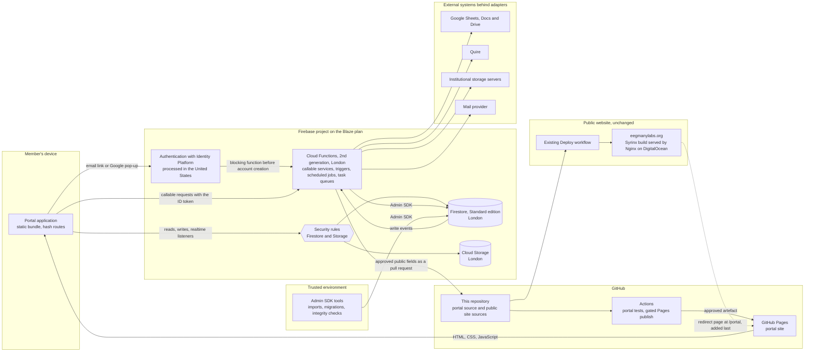

# #EEGManyLabs Hub: architecture

This document assesses how the public website is built and hosted today and describes the architecture recommended for the members' portal. It follows `docs/DECISIONS.md`, which is the contract for the build: the decision log states each decision, and this document supplies the evidence and the design behind it, referring to decisions by number. The security design is in `docs/SECURITY.md` and the data model in `docs/DATA_MODEL.md`.

> **Status.** The evidence here was gathered on 9 November 2026, before the portal package was written. That work was read-only. It created no Firebase project, enabled no Pages site, changed no DNS record or repository setting and triggered no deployment. Sections 5 to 9 therefore describe a design. Progress of the build is to be recorded in `docs/IMPLEMENTATION_STATUS.md` and test results in `docs/TEST_REPORT.md`, neither of which existed when this document was written.

The evidence levels below are used throughout, and a capability is called verified only where code ran.

| Evidence level | Meaning |
|---|---|
| Repository | Read from a file in this repository. |
| Observed | Measured on 9 November 2026 with read-only HTTP and DNS requests, from the GitHub Actions history, or by building the public site in a scratch copy. |
| Emulator | Verified by running code against the Firebase Local Emulator Suite. No real Firebase project was contacted. |
| Documentation | Stated in vendor documentation read on 9 November 2026. Vendor behaviour can change. |
| Designed | Decided or proposed, and not yet built or run. |
| Unverified | Cannot be established until a staging Firebase project and a real Pages site exist. |

## 1. Summary of the assessment

The public website is a static site. Syrinx turns Markdown, TSV data and Jinja templates into files in `dist/`, a container serves them with Nginx, and the container runs on DigitalOcean App Platform in London behind DigitalOcean's edge. DNS for both domains is hosted at DigitalOcean. One GitHub Actions workflow deploys the shared staging site on every pull request and production on every push to `main`, with no path filter. The site has no accounts, no server-side state and no run-time secrets, which is why all of it can be public.

The programme administrator decided on 9 November 2026 that the portal is a static single-page application on GitHub Pages with Firebase as its backend (D-001). Discovery confirmed that this is feasible on the pay-as-you-go Blaze plan with the Identity Platform upgrade, and that the free Spark plan cannot run it. GitHub Pages cannot serve a path beneath `eegmanylabs.org` while that domain points at DigitalOcean, so the recommended address is `portal.eegmanylabs.org` with a redirect page at `eegmanylabs.org/portal` (D-002). The recommended database is Firestore, Standard edition, in London, a location that is permanent once chosen and still needs explicit confirmation (D-003). The public site's deployment workflow, application specification, container definition and server configuration stay exactly as they are (D-004).

A spike ran the stack on the emulators: a static build behind a server that reproduces GitHub Pages behaviour, email-link sign-in, profile claiming, security rules, callable and triggered functions, storage uploads, an idempotent import and a Content Security Policy delivered by a `<meta>` element. Its 177 emulator-backed tests and 15 browser tests passed. Five things could not be proven without a real project and are listed in section 10: the time-based one-time password as a second factor, the acting identity delivered to the audit trigger, App Check enforcement, the Google sign-in pop-up and behaviour on real GitHub Pages. The editor spike for D-010 had not reported when this document was written, so the page editor is provisional.

The choice carries three costs that the administrators are asked to accept knowingly. GitHub Pages gives a site no way to set HTTP response headers, so the portal has no `frame-ancestors` protection, no HSTS header of its own and no policy reporting (section 7). Firebase Authentication processes account data in the United States and its location cannot be chosen. Firestore has no foreign keys, unique constraints or joins, so integrity is built from document identifiers, security rules, transactional functions and a scheduled checker. The expected running cost is roughly US$0 to US$10 a month for about fifty daily active users (section 11). The prerequisites that only the administrators can supply are in section 12.

## 2. The existing website as the foundation

### 2.1 What the site is

| Layer | What it is | Evidence |
|---|---|---|
| Build | Syrinx 0.0.15 converts Markdown in `content/`, TSV rows in `data/` (through `archetypes/`) and Jinja templates in `theme/templates/` into static files in `dist/`. A scratch build produced 17 HTML pages and `sitemap.xml`, 59 MB in all, without errors. | Repository: `requirements.txt`, `syrinx.cfg`, README section 2. Observed: scratch build with Python 3.11. |
| Container | `nginx:alpine`, unpinned, with `nginx.conf` and the contents of `dist/` copied in. Only Syrinx output reaches the container. | Repository: `Dockerfile`. |
| Web server | Static files on port 80. A second server block answers any host that begins with `www.` with a 301 to the same host without it. The configuration sets no security headers, no custom 404 page and no rewrites. | Repository: `nginx.conf`. |
| Platform | One App Platform specification serves both environments through the variable `${TLD}`: app `eegmanylabs-${TLD}`, region `lon`, one service with a single `basic-xxs` instance that runs the image by digest from the GitHub container registry. Production and staging are two separate apps. | Repository: `.do/app.yml`. Observed: the two sites answer with different origin identifiers. |
| Edge | Responses carry `server: cloudflare` together with DigitalOcean origin headers, `cache-control: private` and a cache status of `BYPASS`. This is DigitalOcean's own edge, so the programme has no account in which to add an edge rule or a header. The edge rewrites HTML that contains an email address and injects a decoding script. | Observed. |

### 2.2 Routing, DNS and TLS today

| Subject | Observation |
|---|---|
| Name servers | Both `eegmanylabs.org` and `eegmanylabs.dev` use DigitalOcean's name servers. The zones are controlled from the DigitalOcean account, and the `zone:` entries in `.do/app.yml` let App Platform manage the apex and `www` records. |
| Apex and `www` | The apex has A and AAAA records at the edge. `www` is a CNAME to the app's default hostname, and Nginx redirects it to the apex. |
| Wildcard | Every other label, `portal` included, resolves to the production app through a wildcard record. `https://portal.eegmanylabs.org/` fails in the TLS handshake because no certificate is served for it, so the name is unused. The `.dev` zone has the same pattern. Whether App Platform or a person created the wildcard is not visible from outside. |
| Other records | There is no CAA record, and no GitHub Pages verification record, so the domain is unverified for Pages. |
| TLS | Terminated at the edge, which answers plain HTTP with a 301 to HTTPS. The site sends no `Strict-Transport-Security`, `Content-Security-Policy`, `X-Content-Type-Options`, `X-Frame-Options` or `Referrer-Policy` header. |
| Routing | Directory routes such as `/about/` map to files. A path without its trailing slash is redirected by Nginx to an `http://` address, which the edge then upgrades. `/portal` returns 404 on production and on staging, and `dist/` contains no `404.html`. |

### 2.3 Branch and release rules

`main` is the public release branch, and a push to it deploys production. `review/repository-inspection` is the shared review branch named in README section 1 and is left alone by portal work. New work goes on a focused branch named `type/short-description`, and automated sessions use `claude/<slug>` branches. A pushed branch deploys nothing until a pull request is opened for it. The README's safe route is: build locally, open a pull request, check the staging site, merge after approval, verify production. A rollback is a revert commit on `main`, and shared branches are never force-pushed.

### 2.4 What the deployment workflow does

The repository has one workflow, `Deploy`, in `.github/workflows/deploy.yml`. It chooses the environment with a single test on the Git reference.

| Event | Environment | Steps |
|---|---|---|
| A pull request is opened, updated or reopened, whatever its base branch and whatever files it changes | Staging, `eegmanylabs.dev` | Install Python 3.11 and the requirements, run `syrinx -c -e staging .`, build the image with `no-cache`, push it to the GitHub container registry as `latest`, then deploy the app `eegmanylabs-dev` from `.do/app.yml` with the pushed digest. The staging build carries a `noindex, nofollow` robots tag. |
| A push to `main`, which includes every merge | Production, `eegmanylabs.org` | The same steps with `-e production` and the app `eegmanylabs-org`. |

The Actions history agrees with the file. The workflow is the only one, its recent runs alternate between pull request and push events and all succeeded, and on 29 September 2026 the build timestamps embedded in the staging and production pages match the two runs of that day.

Four consequences matter for the portal. First, the triggers have no path filter, so a pull request that touches only `portal/` or `docs/` redeploys the shared staging site and its merge redeploys production. Scratch builds of `main` and of the working branch were identical apart from the build timestamp (167 files and 59 MB each, with nothing from `portal/` or `docs/` in `dist/`), so such a redeployment is content-neutral today. Second, it is still a real deployment: the image is rebuilt without cache from an unpinned base and Syrinx's transitive dependencies are unpinned. Third, staging is a single shared environment in which the last pull request to build wins. Fourth, the staging or production choice is an expression inside a workflow file that any branch can edit, and the DigitalOcean token is a repository secret. That separation is a convention and an existing property of the repository, which the administrators should know about. Secrets are withheld from pull requests that come from forks.

### 2.5 The legacy redirect repository

`eegmanylabs/website` is a public repository whose content is on the branch `master`. It holds a `CNAME` file naming `www.eegmanylabs.org`, a 202-byte `index.html` that redirects by meta refresh to a page on OSF, and an EEG101 registration guide, last pushed on 23 September 2026.

GitHub Pages is still enabled for that repository with `www.eegmanylabs.org` as its custom domain. A request sent directly to GitHub's Pages servers for that host name returns the 202-byte page, with a modification date equal to the last push, and the repository's default Pages address redirects to the custom domain. No visitor reaches any of it, because public DNS sends `www` to DigitalOcean, where Nginx redirects to the apex. The registration guide is therefore published and unreachable at any working public address. The organisation has no organisation-level Pages site, and Pages is not enabled on this repository.

The legacy site does not conflict with a different subdomain on a different repository. It would block moving the public site itself to Pages, because a custom domain must be unique across all Pages sites. The Pages settings could not be read through the API during discovery, so this account of the legacy site is inferred from HTTP behaviour.

### 2.6 The security boundary of a static site

The public site holds no server-side state, offers no accounts and has no secret at run time. Its privacy page says as much, and its contact form composes a `mailto:` link in the visitor's own mail client. Everything it serves comes from a public repository, and README section 7.5 keeps private data, tokens and spreadsheets out of that repository.

Its integrity therefore depends on four things outside the served files. The first is who can merge to `main` and edit the workflow. The second is the credentials the workflow uses: the run's own `GITHUB_TOKEN` and the repository secrets `GHCR_CREDS` and `DIGITALOCEAN_ACCESS_TOKEN`. The third is third-party code loaded at run time without integrity attributes: Shoelace from `cdn.jsdelivr.net` on every page, Leaflet from `unpkg.com` on the Members and network map pages, and the typefaces from Google Fonts. The fourth is the DigitalOcean account that holds the DNS zones. A static site cannot keep a secret or decide who may read something, so nothing private can ever be placed in it. The portal's boundary, which does carry private data, is described in section 7.

### 2.7 Visual system and navigation

The portal reuses the public site's visual system, read from `theme/assets/css/index.css` and measured on the built pages. Warm graphite `#302a2a` carries text and inverse surfaces, coral `#d84b4d` marks action and current location, deep coral `#a9353a` marks links and hover, warm white `#fcf9f7` and white are the surfaces, and one hairline colour, `#e5dad8`, draws card borders, dividers and input borders. The stylesheet sets DM Sans for all text including headings. Fraunces is declared, and no element of the built site renders in it. Structure comes from 1px borders and spacing, with no elevation shadows and no green, and the layout changes at 560px, 760px and 1020px. The public site styles Shoelace web components. The portal does not load Shoelace and reproduces the measured results with its own components.

A proposed token file maps every colour, radius, type size and control height to a value that already exists in the stylesheet, adds one new breakpoint at 1220px and removes Tailwind's default palettes, shadows and radii so that off-system values cannot be generated. It compiled with Tailwind CSS 4.3.5 against a probe file and has not yet been tried inside the application build. The spike separately verified the mechanism with token values of its own: theme tokens as CSS variables, the absence of box shadows and self-hosted typefaces with no request to a font service. One finding needs sign-off: white on coral measures 4.17:1, which is below the AA threshold for the 13px to 16px labels of a dense interface, so the proposal is deep coral (6.45:1) for dense primary buttons, with coral kept for focus, current-location markers and large labels. The README names coral as the main action colour.

Navigation on the public site is static HTML that `theme/templates/master.jinja2` renders from a fixed list of eight content branches. `/portal` is not a content branch, so a "Members' portal" entry has to be a hard-coded link after that loop. A patch that adds the entry to the header, the mobile menu, the footer and the sitemap page was built and measured in a scratch copy and passes `git apply --check`. It is not applied. Nine header items need about 1120px of content width, so the patch shows the menu button up to a viewport of 1219px, which changes the header between 1020px and 1219px and also needs sign-off. The prepared patch links the entry to `/portal/`. Because the portal has its own origin under D-002, the entry has to point at an absolute address chosen by build environment, and that adjustment to the patch is still to be made. The entry and the redirect page are public-site changes, follow the README route and are made last (section 9).

## 3. The existing public data

Four TSV files in `data/` are the structured data of the public site. Syrinx reads each file with its first column as the record key, renders the matching archetype once per row into a content record, and the card templates turn those records into pages. Filtering and the map run in the browser (`theme/assets/js/site.js` and `network-map.js`). The generated records are build intermediates, which the README keeps out of commits.

| File | Rows | Columns | Natural key | Rendered through | Appears as |
|---|---|---|---|---|---|
| `data/replications.tsv` | 23 | 17 | `StudyId` | `archetypes/replications.md`, `replication_card.jinja2` | Cards on the Replications page with stage and theme filters and a figure named after the `StudyId` |
| `data/publications.tsv` | 18 | 15 | `PublicationId` | `archetypes/publications.md`, `publication_card.jinja2` | Cards on the Publications page with a status filter, preview images and PDFs |
| `data/people.tsv` | 46 | 17 | `PersonId` | `archetypes/people.md`, `people_card.jinja2` | Core Team cards with role tags and portraits |
| `data/members.tsv` | 300 | 5 | `PersonId` | `archetypes/members.md` | The Members directory and the network map |

Three details of these files shape the portal. The README expects 45 Core Team records and 46 rows are present; the map's total of 345 researchers across 30 countries is 300 plus 46 less one duplicate that the map removes in the browser. The first column of `members.tsv` is `SequenceNumber`, so Syrinx keys member records by a running number that changes whenever a row is inserted, and the portal never uses it as an identifier. `StudyId` is the programme's existing study identifier and becomes the canonical replication identifier unchanged (D-013): 23 replications are on the website today, and the decision log records 27 identifiers across the sources.

Everything in `data/` is public, because the repository and the site are public. The files hold names, affiliations, countries, role tags, outward-facing links, study metadata and publication records, and none of them has an email column. The classes of data and where each lives are as follows.

| Class | Examples | Today | With the portal |
|---|---|---|---|
| Public | Names and affiliations approved for the Core Team and Members pages, replication summaries and stages, publications | The four TSV files, the built site and this repository | Unchanged. The portal adds to it only through the publishing route in section 6.5. |
| Member | The programme directory, replication workspaces, laboratory profiles, tasks | The programme's private sources | Firestore documents readable by approved members within their scope |
| Restricted | Email addresses, outreach and recruitment correspondence, private notes, storage paths | The programme's private sources | Separate restricted documents with their own rules (D-006) |
| Special category | Gender and ethnicity | The programme's private sources | A demographics document that no client can read, served through a callable function (D-006) |

The private sources are referred to in this repository by letter and title only, and their locations are held in private configuration (D-012).

## 4. The decision and the options that were assessed

### 4.1 The server-rendered design that was stopped

The first plan was a server-rendered TypeScript application with a PostgreSQL database, deployed as a service on DigitalOcean. It reached the stage of design documents (commit `6937be8`) and was stopped before any code was written. D-001 supersedes it. The requirements checklist records a preference for PostgreSQL where suitable (R18.2), and the administrator's decision is the later and governing statement.

| Concern | Stopped design | Decided design |
|---|---|---|
| Authorisation | A policy module inside a server | Security rules for direct access and callable functions for privileged operations (D-006) |
| Integrity | Foreign keys, unique constraints and database transactions | Natural keys as document identifiers, rule checks, transactional functions and a scheduled integrity checker (D-003) |
| Sessions | Server-side sessions with HTTP-only cookies | Firebase ID tokens held in the browser, valid for one hour, with an access document that rules read on every request |
| Response headers | Full control | None on GitHub Pages (section 7) |
| Operation | An application service, a database and job workers to operate | No server of the programme's own. Google operates the backend on the Blaze plan. |

### 4.2 Four ways to deliver the address

The preferred address was `eegmanylabs.org/portal`. The apex is one host and it points at DigitalOcean, so Pages can only be reached from that address by a redirect.

| | 1. Subdomain on Pages | 2. Default Pages address | 3. Public site moved to Pages | 4. Portal inside the Nginx container |
|---|---|---|---|---|
| Portal address | `portal.eegmanylabs.org` | `eegmanylabs.github.io/eegmanylabs-org/` | `eegmanylabs.org/portal/` | `eegmanylabs.org/portal/` |
| Served by Pages (D-001) | Yes | Yes | Yes | No |
| Public site untouched | Yes, apart from one redirect page added last | Yes, same | No | No: workflow, image and Nginx configuration change |
| `eegmanylabs.org/portal` | Redirect page | Redirect page | Direct | Direct |
| DNS change | One CNAME and one TXT record | None | Apex, `www` and wildcard | None |
| Response headers | None | None | None | Full control |
| Origin that holds sign-in state | Its own | Shared with every Pages project site of the organisation that has no custom domain | Shared with the public site and its third-party scripts | Shared with the public site and its third-party scripts |
| Staging | A second repository on Pages | Same | Has to be rebuilt, and pull request staging is lost | The existing `eegmanylabs.dev` |
| Hosting cost | None added | None added | Saves about US$10 a month | None added |
| Risk to the public site | Low | Low | High | Medium |

Option 1 is recommended (D-002). Options 1 and 2 are the only ones that satisfy both instructions, the portal on Pages and the public site left as it is, and option 1 adds an origin of its own, which is the strongest isolation Pages offers. Option 2 is the same artefact with the DNS steps left out, which makes it the natural interim state and the fallback. It is treated as temporary, because every Pages project site of the organisation without a custom domain shares the one origin `eegmanylabs.github.io`, and a later move to the subdomain changes the origin and makes members sign in again. Option 3 changes the live site's hosting, DNS, staging model and deployment workflow, and first requires the legacy repository to release `www.eegmanylabs.org`. Option 4 gives the strongest headers and sets the Pages decision aside, and it joins the portal and the public site into one image and one deployment.

Firebase Hosting was compared for the static files as well. It can set response headers, rewrite routes and publish a preview for each pull request, and it would add a second deployment target outside GitHub. The decision is Pages. Whether its security posture is acceptable is item 5 of the decisions needed in `docs/DECISIONS.md`.

### 4.3 Firestore or the PostgreSQL-backed Firebase service

Firebase offers a PostgreSQL-backed service, Firebase SQL Connect (formerly Data Connect), which runs on Cloud SQL. It was assessed against Cloud Firestore from the documentation.

| Aspect | Cloud Firestore, Standard edition | Firebase SQL Connect |
|---|---|---|
| Realtime | Listeners on any query, an offline cache and optimistic writes | Automatic refresh for single-row lookups by primary key only. Lists, joins and aggregations need an explicit refresh directive on each operation ([realtime](https://firebase.google.com/docs/sql-connect/realtime)). |
| User-defined views | Scoped documents are loaded once and filters, sorts and groupings are computed in the browser (D-011) | Queries and mutations are predefined and stored on the server at deployment, so each shape of view must exist in advance or go through a privileged function |
| Authorisation | Per-document, per-operation rules with lookups of other documents, covered by a unit-testing library | Per predefined operation, by an expression over the sign-in token |
| Cost floor | A free daily quota, then usage. About US$0 to US$5 a month expected here. | A Cloud SQL instance from about US$9.37 a month after a three-month trial ([pricing](https://firebase.google.com/docs/sql-connect/pricing)) |
| Maturity of the parts needed | Triggers, point-in-time recovery, backups, the emulator and rules testing are long established | Realtime support arrived in 2026, native SQL is a preview, and the emulator runs an embedded database that may differ from Cloud SQL |
| Given up | Foreign keys, unique constraints, joins and server-side full-text search | Live lists, and views that a member defines at run time without a predefined operation for each |

Firestore is recommended (D-003). The price of the choice is that referential integrity, uniqueness, roll-ups and search become application responsibilities, met by the four mechanisms that D-003 lists. The Enterprise edition of Firestore adds joins and text search through pipeline queries, which are not live, so the Standard edition is the starting point and Enterprise remains a migration by export and import. The location is permanent once chosen.

## 5. Target architecture

### 5.1 Component overview

Members' data travels directly between the browser and Google's services. GitHub serves the application's files, logs the visitor's IP address and receives programme data only as the approved public fields of the publishing route.

### 5.2 Components

Trust levels are used as follows. An untrusted component runs where the programme has no control, and nothing it does is relied on for security. An enforcing component decides access on every request. A trusted component runs with the Admin SDK, which bypasses security rules, and so has to authorise its own callers. An operator component is trusted code that a named person starts.

| Component | Responsibility | Location in the repository | Trust level |
|---|---|---|---|
| Shared code | Document schemas, collection paths, identifier derivation, callable contracts and pure domain logic, used by the application, the functions and the tools so that each is declared once. It imports nothing from Firebase. | `portal/shared` | Carries no authority of its own. It is as trusted as the code that runs it. |
| Browser application | Presentation, navigation with hash routes such as `#/replications/AmodioJost2007`, forms, optimistic updates, views computed over loaded documents (D-011) and validation of everything read. Built to static files with relative asset addresses. | `portal/web` | Untrusted. The bundle is public and runs on the member's device. |
| Firestore security rules | The decision on every direct read and write: role and scope, natural-key consistency, existence of referenced documents, append-only collections and a shape floor for client writes (D-006). | `portal/firestore.rules` | Enforcing |
| Cloud Storage rules | Owner, size, content type and write-once checks on uploads. | `portal/storage.rules` | Enforcing |
| Cloud Functions | Callable services for privileged and multi-document changes, Firestore triggers for the audit trail and derived fields, scheduled jobs such as the integrity checker, task queues for retrying work, and the adapters for external systems (D-007, D-014). | `portal/functions` | Trusted |
| Admin SDK tools | Importers, migrations, seeding of demonstration data and integrity checks, run from an administrator's machine or a protected workflow (D-012). | `portal/tools` | Operator |
| Tests | Rules tests that prove each denial, function and tool tests, and browser tests, all against the emulators under a demonstration project identifier (D-016). | `portal/tests` | None in production. They contact no real project. |
| Firebase Authentication | Passwordless sign-in, the second factor and the signed ID token that rules and functions verify (D-015). | Project configuration, outside the repository | Trusted identity provider, operated by Google |
| External systems | Google Sheets, Docs and Drive, Quire, institutional storage servers and a mail provider, each reached through an interface with a real implementation and a fake used in tests. A writing adapter defaults to a dry run (D-014). | Interfaces and adapters in `portal/functions` | Separate trust domains. Their content is treated as input to be validated. |
| Public website | The existing Syrinx site and its `Deploy` workflow. It receives approved public fields only, as a pull request. | `content/`, `data/`, `theme/`, `.github/workflows/deploy.yml`, all unchanged | Public |
| Pages publishing workflow | Builds and tests the application and publishes the artefact after a reviewer approves. | Proposed as `.github/workflows/portal-pages.yml` | A security control, because the bundle is the trust root of the application |

The division of decisions between the layers follows the spike's recommendation.

| Layer | What it decides |
|---|---|
| Cloud Functions | Linking an account to a person and everything that touches the email index, writing access documents and mirroring a few flags into custom claims, the audit trail and derived fields, changing an email address, offboarding, scheduled integrity checks, and any write that spans several documents or needs a decision the caller must not influence |
| Security rules | Who may read or write which document by role and scope, natural-key consistency and existence of references on creation, append-only and immutable-field guarantees, the shape floor for client-writable documents (keys, types, ownership and server time), and bounded list queries limited to the caller's scope |
| Browser application | Presentation, navigation, optimistic updates, form validation and reaction to a change of role. Nothing that security depends on. |
| Admin SDK tools | Imports, migrations and integrity checks that an operator runs |

Workspace pages are the one provisional component. D-010 proposes a block editor whose concurrent edits are Yjs updates stored as Firestore documents and delivered by realtime listeners, with version history as stored snapshots. No evidence for it exists yet, and this section will be completed when the editor spike reports.

## 6. Request and data flows

### 6.1 Sign-in and profile claiming

A member opens the portal and enters an email address. The application asks Firebase Authentication to send a single-use link whose return address is the portal's own origin, which has to be on the project's list of authorised domains. By the documentation, the link first opens Firebase's handler on the project's Firebase-managed domain and is then forwarded to the portal, where the application completes the sign-in. No documentation page states explicitly that an email-link sign-in may complete on a host other than Firebase Hosting, so the complete path against a real project remains to be confirmed on staging (section 10). The address is remembered in local storage for a return on the same device and is asked for again on another device. On the emulators the link worked once and only for the address it was sent to. The alternative is Google sign-in through a pop-up window, which the Firebase documentation lists among the options for an application hosted outside Firebase ([redirect best practices](https://firebase.google.com/docs/auth/web/redirect-best-practices)). If the account has a second factor, sign-in pauses for the code. That step ran on the emulators with an SMS factor and is unverified for time-based one-time passwords.

After sign-in the application calls a function that takes no arguments. The function reads the caller's verified address from the ID token, looks it up in an email index that no client can read, and in one transaction links exactly one unclaimed person to the account and writes the account's access document (D-005). An address that matches several people, or a person who is already claimed, produces a review item for an administrator and the same neutral answer to the caller. The spike's version of this function passed nine tests, including one in which two accounts raced for the same person and exactly one was linked. The spike derived lead and coordinator scopes directly from the imported data. Under D-005 those management roles start in a pending state and an administrator confirms them, which is a change the build makes to the spike's function.

Firebase creates an account for any address that completes a link, so being signed in confers nothing. Rules grant access only through the access document, and only a successful claim marks an account there as a member. A blocking function that runs before account creation can refuse an address outright. It ran on the emulators and needs Identity Platform in production. Whether the setting that disables self-service sign-up also covers email links is unverified.

### 6.2 A member reads and edits a record with a live linked view

An approved member opens a replication. The data layer attaches a realtime listener to the document through a typed converter that validates every snapshot against its schema. Before any data is returned, the rules read the member's access document and check membership, role and scope, which costs one billed document read for each evaluated request. Every view that asks for the same document shares one listener and one cached value, so a programme dashboard, a replication page and a laboratory page render the same document (D-011). On the emulators a header and a summary card bound to one replication both showed an edit made in a dialog, and a second browser tab received it through the shared cache.

When the member edits a field, the client writes the change directly. The rules decide again: the role and scope have to allow the write, only the permitted keys may change, the document has to keep its shape, and the modification time has to be the server's. The listener then delivers the new state to every open view, for this member and for everyone else who has the record open, and a Firestore trigger writes the audit entry, normally within seconds (D-007). Lists work the same way with one condition that comes from Firestore. A rule is evaluated against everything a query could return, and the whole query is refused if any possible result would be denied, so each list query is itself limited to the member's scope and bounded in size. The spike's rules refused a list with no constraint, a list for another laboratory and a list without a limit. With the persistent cache enabled, an edit made offline appeared at once as pending and synchronised after reconnection.

### 6.3 A privileged change through a callable function

Changes that span several documents, or that the caller must not be able to influence, go through callable functions in `europe-west2`. Confirming a pending role is an example. The application calls the function with the member's ID token. The function checks that the caller is signed in, reads the caller's access document to confirm the role and that the account is neither disabled nor revoked, and requires the second factor where D-015 demands one. It then runs one Admin SDK transaction that makes the change and writes the audit entry, so neither exists without the other (D-007). A trigger mirrors a few flags into custom claims for the interface, while the rules keep reading the access document, so a removed role stops working on the next request.

Three details come from the spike. Production callable functions verify the signature of the token and leave revocation unchecked, so a sensitive function checks revocation itself or reads the access document. The functions emulator verifies no signature at all, so an emulator pass proves the logic of a function and proves nothing about token verification. After an SMS challenge the emulator's token carried a second-factor claim, and the equivalent for a time-based one-time password is unverified.

Reading special-category demographics follows the same path. No client can read that document, and a callable function checks the caller's grant and second factor, writes an audit entry and returns the data (D-006). The spike proved the split into directory, contact and demographics documents. Its rules still let the person concerned and the holder of an explicit grant read the demographics document directly, and refused programme administrators, the core team, leads, coordinators and ordinary members. Closing every direct client read and serving the document through an audited function is designed and was outside the spike.

### 6.4 An import run

An operator runs an import from a trusted environment: an administrator's machine, or a protected workflow that obtains short-lived Google credentials through workload identity federation with no stored key (D-012). The tool uses the Admin SDK, which bypasses security rules, and for that reason it never runs in the browser or from the public site. Source locations come from private configuration outside the repository. The tool first reports what it would do in a dry run. A real run stores each source row verbatim in a restricted collection, derives document identifiers deterministically from natural keys, reads the existing documents, compares only the fields the import owns and writes the difference. Each record is linked to the rows it came from, and a disagreement between sources becomes a review item for a person to resolve.

The spike verified the core of this on synthetic data. A first run created 14 documents. A second run changed none of them, left every update time identical and caused no audit entry. A run after a manual edit restored only the import's own fields and kept the link made by the claim. The scripts refused to touch a project unless they were pointed at the emulator or given an explicit production flag, and the integrity checker found each of four planted orphans. Verbatim row storage, provenance links and the review queue are designed and were outside the spike.

### 6.5 Publishing approved public fields to the website

Publishing is designed for phase 9 and none of it is built. The public site keeps its single publishing route: a change to the TSV files in `data/` arrives as a pull request, the existing workflow deploys it to staging, a maintainer checks `eegmanylabs.dev` and merges, and the merge deploys production. The portal feeds that route. A function assembles the fields approved for publication into the shape of the existing TSV files and shows an administrator a preview with the differences from what is published. After approval, the website adapter opens a pull request against this repository. From there the README's release steps apply unchanged, including rollback by a revert commit.

Three safeguards follow from the evidence in section 2. The adapter defaults to a dry run and a live pull request needs explicit approval (D-014), because opening one redeploys the shared staging site. The export is built from a list of approved public fields, so contact details, demographics, private notes and participant data have no path into it. Each publication is logged with its approver and the resulting commit.

## 7. The security boundary of the portal

### 7.1 Where the boundary lies

The portal's files are public. Anyone can read the bundle, the route names, the interface text and the Firebase web configuration, which Google documents as safe to publish ([API keys](https://firebase.google.com/docs/projects/api-keys)). Nothing sensitive is compiled into the bundle, and nothing the application does in the browser is relied on. The boundary sits at Google's services: Authentication establishes who the caller is, security rules decide every direct read and write, and functions decide every privileged operation. App Check complements these by attesting that requests come from the real application, and its enforcement is unverified.

Two consequences follow. Code that runs with the Admin SDK bypasses the rules, so functions and tools are trusted code and each function authorises its own caller. The bundle is the trust root of the application wherever it is hosted, so the protection of `main` and the gated publishing workflow are security controls in their own right.

### 7.2 What GitHub Pages cannot provide and how the portal compensates

GitHub Pages offers no way to set a response header. The Pages documentation describes none, responses observed from Pages sites carry none of the security headers, and a policy delivered by a `<meta>` element cannot carry `frame-ancestors`, `sandbox` or reporting directives and has no report-only mode ([CSP Level 3](https://www.w3.org/TR/CSP3/#meta-element)).

| Control | On GitHub Pages | What the portal does | Evidence |
|---|---|---|---|
| Content Security Policy | By `<meta>` element only | The policy is generated at build time and placed at the top of `<head>`, directly after the character-set declaration: `default-src 'none'`, `script-src 'self'` with no inline script, an explicit `connect-src` list of the Firebase endpoints in use, `object-src 'none'`, `base-uri 'self'` and `form-action 'self'`. Styles keep `'unsafe-inline'` because the dialog component injects one style element. | Emulator: no violation in any online flow, a request to an unlisted port was blocked and an injected inline script did not run. The production host list was derived from the SDK sources and is unverified against production. |
| Clickjacking protection | Unavailable. `frame-ancestors` is ignored in a `<meta>` policy and `X-Frame-Options` is a header. | A script check that the application is the top-level window. It is weaker than a header, and the remaining risk is part of what the administrators are asked to accept. | Emulator: the browser ignored the directive and the application rendered inside a foreign frame. The script check is designed. |
| Violation reporting and report-only trial | Unavailable | Violations are collected inside the page with a `securitypolicyviolation` listener, and a changed policy is trialled enforced on staging. | Documentation. The listener is designed. |
| `Strict-Transport-Security` | Unavailable | HTTPS is enforced by GitHub's redirect once "Enforce HTTPS" is set, and the production policy adds `upgrade-insecure-requests`. | Documentation. Unverified on the real site. |
| `X-Content-Type-Options`, `Permissions-Policy`, cross-origin opener and embedder policies | Unavailable | No equivalent exists. | Documentation and Observed. |
| Referrer policy | Available by `<meta name="referrer">` | `strict-origin-when-cross-origin` | Present in the spike's build |
| Passwords | GitHub states that Pages should not be used for sensitive transactions such as sending passwords ([limits](https://docs.github.com/en/pages/getting-started-with-github-pages/github-pages-limits)) | The portal has no password field (D-015). Credentials for Google sign-in are entered on Google's pages. | Documentation |
| Origin isolation | A custom subdomain is an origin of its own | Nothing else is served from `portal.eegmanylabs.org`, all third-party code is bundled and the typefaces are self-hosted (D-002). | Emulator: the application requested scripts and fonts from its own host only. |
| Public artefact | Site and source are public | The proposed publishing workflow refuses to publish source maps, environment files or key files. | Designed |
| Revocation | A matter for Firebase: an ID token stays valid for up to an hour | Rules read the access document, which carries a disabled flag and a revocation time, so a disabled account or a removed role is refused on the next request. | Emulator, with tokens issued by the Authentication emulator |
| Stale application after a release | A fixed ten-minute cache | The application compares a small version file and reloads after a failed chunk load. | Observed cache header. The recovery is designed. |
| Data left on a device | A matter for the browser | Sign-out drops every listener and in-memory value. Firestore's persistent cache stays on the device between sessions, and special-category data never enters it because no client reads it. Google's guidance is to ask whether a device is trusted before enabling persistence, and that choice is open. | Emulator: sign-out cleared the user and returned a second tab to the sign-in page. The rest is designed. |

### 7.3 Where data is processed

These are facts for the administrators' decision and are not legal advice. Controller obligations such as the lawful basis, the impact assessment, retention periods, records of processing and breach handling remain with the programme.

| Service | Location facts | Source |
|---|---|---|
| Firebase Authentication | Run only from data centres in the United States, with no choice of location. It processes email addresses, IP addresses and user agents. | [Firebase privacy](https://firebase.google.com/support/privacy) |
| Cloud Firestore | The location is chosen at creation and is permanent. Google commits to storing customer data at rest within the selected region. | [Data residency terms](https://cloud.google.com/terms/data-residency) |
| Cloud Functions, Cloud Storage, Secret Manager, Cloud Logging | On Google Cloud's data residency list, with a region chosen for each resource | Same |
| Cloud Tasks and Cloud Scheduler | Absent from the data residency list. Task payloads therefore carry document identifiers only. | Same |
| App Check | No location choice. With reCAPTCHA Enterprise it sends browser signals to Google for scoring. | [Firebase privacy](https://firebase.google.com/support/privacy) |
| GitHub Pages | Serves static files only and logs each visitor's IP address | [About GitHub Pages](https://docs.github.com/en/pages/getting-started-with-github-pages/what-is-github-pages) |

By design, gender and ethnicity are held only in Firestore in London and never enter Authentication, custom claims, logs, task payloads, email or synchronised spreadsheets. Scheduled backups can be retained for up to 14 weeks and point-in-time recovery covers seven days, which an erasure procedure has to take into account.

## 8. Environments

| Environment | Front end | Backend | Data | State |
|---|---|---|---|---|
| Development and automated tests | A local build behind a static server that reproduces Pages behaviour: no rewrites, `404.html` with status 404, no custom headers | The emulators for Authentication, Firestore, Functions and Storage under a project identifier with the `demo-` prefix (D-016) | Synthetic fixtures | Ran in the spike with no credential |
| Staging | A second Pages site, published from a second public repository for a chosen branch, preferably on a subdomain of its own (D-017) | A second Firebase project | Synthetic data only | Designed. Needs an organisation owner, DNS records and a billing account. |
| Production | The Pages site of this repository at `portal.eegmanylabs.org`, or at its default Pages address in the interim (D-002) | The production Firebase project, with Firestore, Functions and Storage in `europe-west2` | Imported and live programme data | Designed. Needs the approvals in section 12. |

A project identifier with the `demo-` prefix has no real resources, and a call to anything that is not emulated fails, so a test cannot touch production or incur cost. App Check is the exception, because it has no emulator and its SDK calls Google's hosts regardless, so it stays switched off in emulator builds. Each Firebase project has its own users, database, bucket, functions, rules and authorised domains. The web configuration of each is committed, being public by design, and is selected at build time.

Staging is a Pages site so that it shares the header, cache and routing behaviour of production. That matters because a `<meta>` policy can only be tested enforced. A repository has exactly one Pages site and Pages offers no pull request previews, which is why staging needs a repository of its own. It is shared, and the last branch published to it wins. The public site's own environments are unchanged: the local preview, `eegmanylabs.dev` and `eegmanylabs.org`.

## 9. Deployment and release

| Activity | Starts when | Automation | Gate | State |
|---|---|---|---|---|
| Public site to staging | A pull request is opened or updated | Automatic | Opening the pull request | Existing and unchanged |
| Public site to production | A push to `main` | Automatic | Review and merge of the pull request | Existing and unchanged |
| Portal checks: type check, layer-boundary check, rules, function and tool tests, browser tests | Proposed for pushes and pull requests | Automatic, with no credential or secret | None needed, because it deploys nothing | Ran locally in the spike. The Actions job is a sketch that has not run. |
| Portal front end to production Pages | A maintainer starts the workflow by hand | The build and tests run, then the deploy job waits | A required reviewer on the protected `github-pages` environment, with self-review prevented, deployments limited to `main` and administrator bypass switched off | Proposed and validated as YAML only |
| Portal front end to staging Pages | A reviewer starts a workflow in the staging repository for a chosen branch | As above | A lighter reviewer gate | Designed |
| Security rules, indexes and functions to Firebase | A separate workflow started by hand | Automatic after approval | Environment reviewers, with Google credentials obtained through workload identity federation | Identified as needed and not yet designed |
| Imports and migrations | An operator runs a tool | Manual | A dry run, an explicit production flag and administrator approval | The pattern ran on the emulators |
| Live writes to external systems, including a pull request to the public site | An adapter is switched from dry run to live | Manual | Explicit administrator approval (D-014) | Designed |
| Redirect page and navigation entry on the public site | A pull request through the README route, made last | The existing workflow | Approval as for any public-site change | The navigation patch is prepared and not applied |

The existing `deploy.yml`, `.do/app.yml`, `Dockerfile` and `nginx.conf` are unchanged (D-004). Because `deploy.yml` has no path filter, portal pull requests and merges keep redeploying the public site with unchanged content, and placing the publishing workflow on `main` costs one such staging deployment and one such production deployment. The front-end deployment needs no secret in GitHub: Pages accepts the run's own identity token.

Three properties of GitHub Actions decide the order of work. A workflow that has only a manual trigger cannot be started until its file is on the default branch. A workflow that names an environment which does not exist creates it without any protection, so a repository administrator creates and protects `github-pages` before the workflow file reaches `main` ([managing environments](https://docs.github.com/en/actions/how-tos/deploy/configure-and-manage-deployments/manage-environments)). A manual run started against another branch executes that branch's copy of the workflow file, so the environment's rules, which live in settings, are the real control and the conditions written in the file are a convenience.

A release is rolled back by re-running the deploy job of the last good run while its artefact is retained (30 days in the proposal), which waits for approval again, or by reverting on `main` and starting the workflow. After any release Pages may serve the previous `index.html` for up to ten minutes.

## 10. What the spike verified

The spike ran on 9 November 2026 against the emulators with a demonstration project identifier, using no Firebase project and no credential, and its browser tests asserted that no request left the machine. One command built the functions and the site, started the emulators and ran 177 emulator-backed tests and 15 browser tests in 87 seconds, all passing. The versions exercised together were the Firebase JavaScript SDK 13.2.0, `firebase-admin` 14.5.0, `firebase-functions` 7.4.0, `firebase-tools` 15.35.0, React 19.3.1, React Router 8.5.1, Vite 8.3.7, TypeScript 7.0.2, Tailwind CSS 4.3.5 and zod 4.6.7, on Node.js 22 with Java 21.

| Capability | How it was verified | Result |
|---|---|---|
| Static build with a configurable base path | Three builds of the same sources behind a Pages-like static server, with browser tests signing in and following deep links under each | Verified on the Pages-like server |
| Deep links through `404.html` | The server answered 404 with the fallback body and the page restored the original address, query and fragment included. A hostile value could not leave the base path or the origin. | Verified. The target uses hash routes (D-002), which the spike did not exercise, and keeps a `404.html` copy as a safety net. |
| Theme tokens as CSS variables, no shadows, self-hosted typefaces | Computed styles and the set of requested hosts read in the browser | Verified with the spike's own token values. The proposed token file of section 2.7 was not part of the spike. |
| Email-link sign-in | The link was read from the emulator's out-of-band endpoint, in Node tests and through the real form in the browser | Verified: single use and bound to its address |
| Second-factor challenge after an email link | An SMS factor was enrolled and a new sign-in was completed through the challenge | Verified with SMS only |
| Disabling and revoking an account | Admin SDK calls followed by requests with the same token | The access-document rules refused the next request. With custom claims alone, access continued until the token was refreshed. |
| Typed data access and layer boundaries | Schema-backed converters, and a build check that fails when a route or component imports Firestore, Storage, Functions or the schema library directly | Verified |
| Live linked views, multi-tab cache and offline write | A browser test with two mounted views, two tabs and an offline context | Verified |
| Security rules | 66 policy tests run against two role mechanisms, 45 of them named as denials, with 4 revocation tests. Every `allow` statement has a test in which an unauthorised caller is refused. | Verified |
| Separate contact and demographics documents | Rules tests for each role | Verified: programme administrators and the core team were refused the demographics document |
| Natural keys, append-only collections, rule-level schema and scoped lists | Rules tests | Verified. Rule-level schema is practical as a floor for flat documents, and rich validation stays in the shared schemas. |
| Access documents compared with custom claims (D-006) | Both rule sets were implemented and tested | Access documents are recommended as the authority: revocation is immediate and there is no size ceiling, at the price of one extra read per request. Claims are limited to 1,000 bytes and can be an hour stale. This supports the mechanism that D-006 names. |
| Profile claiming | 9 function tests, including a race between two accounts | Verified |
| Audit trigger | Field differences, redaction of configured fields and three deliveries of one event | Verified: one entry per event. The acting identity was a placeholder. |
| Scheduled function | Invoked over HTTP, because the emulator runs no schedule | Verified |
| Blocking function before account creation | Sign-up from a blocked domain, by password and by email link | Verified after a fresh emulator start |
| Secret through the parameters API | A probe returned the length and a hash prefix of the local value | Verified on the emulator |
| Idempotent import and integrity checker | 6 tests | Verified |
| Storage upload under rules | 6 rules tests and a browser upload | Verified: owner only, PDF, PNG or JPEG, a 5 MiB limit, write-once |
| App Check wiring | The debug provider, with the two external requests answered inside the browser test | Wiring verified. Enforcement cannot be tested locally. |
| Content Security Policy by `<meta>` | Every online flow, a blocked request and a blocked inline script | Verified against the emulators |
| End-to-end journey | Sign-in, claim and dashboard for one synthetic member, then a second member who was refused the first one's contact document | Verified |

The policy work produced three findings that the build keeps. The schema library probes for dynamic code evaluation on first use and has to be configured to skip it. The dialog component injects one inline style element, which is why styles keep `'unsafe-inline'`. Firestore requests one image from a Google address to test connectivity after a failure, and the production policy lists that address.

The following could not be verified and remain open until a staging project and a staging Pages site exist.

| Not verified | Why the emulators cannot show it | What was shown instead | How it is settled |
|---|---|---|---|
| Second factor by time-based one-time password (D-015, D-016) | The Authentication emulator implements SMS factors only | The enrolment and challenge code is type-checked and wired to the interface, and the challenge flow ran with an SMS factor | A browser test on staging: enable the factor through the Admin SDK, enrol, compute codes inside the test and sign in again |
| The acting identity in the audit trigger (D-007) | The Firestore emulator sends the same fixed placeholder values for every write | Differences, redaction and idempotency ran, and a production-shaped event was delivered by hand | Read the values that a signed-in member's write produces on staging. Until then every client write records its author in the document, which rules enforce. |
| App Check enforcement | App Check has no emulator, and the functions emulator accepts unsigned tokens | The client wiring, the attachment of tokens to requests and the refusal of a call with no token | Register a debug token and switch enforcement on for each product on staging |
| The Google sign-in pop-up | It loads a script from Google that the spike did not fetch | The button is controlled by a build flag, and the emulator accepted a Google credential and linked it to the email-link account | Run the pop-up on the staging site under its authorised domain |
| Behaviour on real GitHub Pages | The spike used a local server that reproduces three Pages behaviours | No rewrites, the `404.html` response and the absence of custom headers | Publish the staging site and check the headers, the ten-minute cache, HTTPS enforcement, the custom domain and the production policy's host list |

Several smaller points are inferred from documentation or source code and remain to be confirmed in the same pass: that an email-link sign-in completes on a host other than Firebase Hosting against a real project, that an account created by email link can enrol a time-based one-time password, that an administrator's reset removes such a factor, that a revoked refresh token stops refreshing (the emulator continued to refresh it), and what Firebase returns when a link is requested for an unknown address.

## 11. Costs and limits that shape the design

| Item | Fact | Source |
|---|---|---|
| Spark plan | Five sign-in link emails a day, no Cloud Functions and no Cloud Storage. The portal cannot run on it. | [Authentication limits](https://firebase.google.com/docs/auth/limits), [Functions](https://firebase.google.com/docs/functions/get-started), [Storage changes](https://firebase.google.com/docs/storage/faqs-storage-changes-announced-sept-2024) |
| Blaze plan | 25,000 sign-in link emails a day. Usage beyond the free quota is billed, and budget alerts do not cap spending. | [Authentication limits](https://firebase.google.com/docs/auth/limits), [pricing plans](https://firebase.google.com/docs/projects/billing/firebase-pricing-plans) |
| Firestore free quota | 1 GiB stored and 50,000 reads, 20,000 writes and 20,000 deletes a day | [Firestore quotas](https://firebase.google.com/docs/firestore/quotas) |
| Firestore prices in London | US$0.039 for 100,000 reads, US$0.117 for 100,000 writes and US$0.117 for a GiB stored for a month | [Firestore price list](https://cloud.google.com/firestore/pricing) |
| Listener billing | One read for each document in the first result and one for each later change. A listener that was offline for more than 30 minutes is billed as a new query. Each document that rules read costs a read, even when the request is refused. | [Firestore pricing](https://firebase.google.com/docs/firestore/pricing) |
| Identity Platform | No charge below 50,000 monthly active users, and no charge listed for time-based one-time passwords | [Identity Platform pricing](https://cloud.google.com/identity-platform/pricing) |
| Cloud Functions | 2,000,000 invocations a month free. Scheduled jobs cost US$0.10 each a month beyond three. | [Firebase pricing](https://firebase.google.com/pricing) |
| Cloud Storage in London | No free quota outside three regions in the United States. A few gigabytes cost cents a month, and the unit price was not verified. | Same |
| App Check | reCAPTCHA Enterprise is free up to 10,000 assessments a month for the organisation. A longer token lifetime keeps usage below that. | [reCAPTCHA pricing](https://cloud.google.com/recaptcha/pricing) |
| Expected total | About US$0 to US$10 a month for about fifty daily active users, dominated by Firestore reads. A careless implementation that reloads whole collections would cost US$15 to US$25. A budget alert at about US$25 is recommended. | Estimate from the prices above |

| Limit | Value | Consequence for the design |
|---|---|---|
| Document size | 1 MiB ([quotas](https://firebase.google.com/docs/firestore/quotas)) | A workspace page is never a single document. Under D-010, which is provisional, edits are stored as many small update documents with periodic snapshots. |
| Document reads inside rules | 10 for a single-document request or a query, 20 for a transaction or batch ([rules conditions](https://firebase.google.com/docs/firestore/security/rules-conditions)) | Rules read the access document and at most a few referenced documents. The spike's most expensive request read three. Larger changes go through functions. |
| Read rules apply to whole documents | A rule cannot hide a field ([rules and fields](https://firebase.google.com/docs/firestore/security/rules-fields)) | Contact details and demographics are separate documents (D-006). |
| Queries are allowed or refused as a whole | A list query has to satisfy the rule for every possible result ([rules and queries](https://firebase.google.com/docs/firestore/security/rules-query)) | Scope is part of each query and lists are bounded. The spike's rules capped a list at 100 documents. |
| Query features | No joins, no grouping and no full-text search in the Standard edition. Aggregation queries are unavailable to listeners. | Views, roll-ups and search are computed in the browser over a few thousand documents (D-011). |
| Custom claims | 1,000 bytes, refreshed with the token ([custom claims](https://firebase.google.com/docs/auth/admin/custom-claims)) | Claims mirror a few global flags. Scoped roles stay in the access document. In the spike 64 twelve-character keys fitted and the 65th did not. |
| ID token lifetime | One hour ([sessions](https://firebase.google.com/docs/auth/admin/manage-sessions)) | Revocation works through the access document. |
| Trigger delivery | At least once and unordered ([Firestore triggers](https://firebase.google.com/docs/functions/firestore-events)) | Audit entries use the event identifier as their document identifier and may lag the write by seconds (D-007). |
| Blocking functions | An answer within 7 seconds ([blocking functions](https://firebase.google.com/docs/auth/extend-with-blocking-functions)) | They are kept to an allow or refuse decision. |
| Data location | Permanent once chosen | London is confirmed explicitly before the production project is created (D-003). |
| Pages cache | `max-age=600` on every successful response observed. Caching is undocumented and not configurable. | `index.html` can be ten minutes stale after a release, so the application checks a version file and recovers from a failed chunk load. |
| No rewrites on Pages | An unknown path returns the `404.html` body ([custom 404 pages](https://docs.github.com/en/pages/getting-started-with-github-pages/creating-a-custom-404-page-for-your-github-pages-site)). The documentation does not give the status, which was observed as 404 on a Pages site. | Hash routes and relative asset addresses (D-002). Sign-in links return to the site root with query parameters. |
| Pages sites | One site for each repository, one custom domain for each site and no pull request previews | Staging is a second repository (D-017). |
| Pages size and traffic | A site of up to 1 GB, a soft limit of 100 GB of traffic a month and a ten-minute deployment timeout | No practical constraint for a bundle of a few megabytes |
| Bundle size | One chunk of 1.2 MB, 356 kB compressed, in the spike | The bundle is split by route before launch. |
| Google Sheets API | 300 reads and 300 writes a minute for the project and 60 for each user, and a service account counts as one user ([Sheets limits](https://developers.google.com/workspace/sheets/api/limits)) | Synchronisation runs in a rate-limited task queue with backoff. |
| Drive ownership | A service account cannot own files ([shared drives](https://developers.google.com/workspace/drive/api/guides/about-shareddrives)) | Generated documents need a shared drive or a person's own grant. |
| Test environment | Java 21 for the emulators, Node.js 24.12 or later declared by version 13 of the SDK (Node.js 22 ran it with warnings), and a peak of 4.3 GB of memory for the spike's suite | A standard hosted runner is sufficient, and continuous integration uses Node.js 24. |

## 12. Prerequisites and approvals

The decisions that the programme administrators are asked to make are listed once, at the end of `docs/DECISIONS.md`, and are referred to here by their item number. This table adds who can act and what each prerequisite blocks.

| Prerequisite | Who can supply it | What waits for it | Reference |
|---|---|---|---|
| A billing account on the Blaze plan with a named owner and budget alerts, and the upgrade to Authentication with Identity Platform | Programme administrators and the owner of the Firebase projects | Every real project: sign-in beyond five emails a day, functions, storage, the second factor and blocking functions | Item 1, D-001 |
| London as the permanent location | Programme administrators | Creation of the production project | Item 2, D-003 |
| A decision on the processing of account data in the United States | Programme administrators | Inviting members | Item 3, section 7.3 |
| The portal address | Programme administrators decide. An organisation owner verifies the domain for Pages, the holder of the DigitalOcean account adds one TXT and one CNAME record, and a repository administrator enters the custom domain and enforces HTTPS. | The subdomain. The default Pages address needs none of the DNS steps. | Item 4, D-002 |
| Acceptance of the security posture of GitHub Pages | Programme administrators | Publishing the portal to members | Item 5, section 7.2 |
| Where the portal source lives | Programme administrators | Nothing at present. It decides whether portal changes keep redeploying the public site. | Item 6, D-004 |
| The protected `github-pages` environment with named reviewers, and Pages set to publish from GitHub Actions | A repository administrator, before the workflow file is merged | Any publication to Pages | D-004, section 9 |
| The staging repository, its domain records and the staging Firebase project | An organisation owner, the holder of the DigitalOcean account and the owner of the Firebase projects | Everything in the second table of section 10 | D-017 |
| Read access to sources A and G, a Quire export or token, and a mail provider | Programme administrators | Import of A and G, migration of tasks and notification email | Item 7, D-012 |
| Restricted link sharing on source F and the contributor sheets | The owners of those documents | Nothing in the build. It reduces exposure once the import has been verified. | Item 8 |
| A Google Workspace shared drive, and designated files shared with the portal's service account | Programme administrators and the owners of the files | Generated documents and two-way synchronisation | D-014 |
| A recovery procedure for a lost second factor | Programme administrators | Requiring the second factor of administrators. Firebase provides no recovery codes. | D-015 |
| Sign-off on deep coral for dense primary buttons and on the navigation entry with its header breakpoint | Programme administrators and the site's maintainers | Phase 1 styling and the final rollout step | Section 2.7 |

Discovery also found matters outside the portal that the administrators may wish to act on. The legacy Pages site still claims `www.eegmanylabs.org` and its registration guide is unreachable. Both domains have wildcard DNS records, and it is unconfirmed whether a record added by hand survives an App Platform deployment. The staging or production choice and the DigitalOcean token are reachable from any pull request branch of this repository. The public privacy page states that the site provides no user accounts, so it needs revising when the portal entry is added, and the portal needs a privacy notice of its own that covers GitHub's logging of IP addresses and the Google services in use.
